# Entropy's Defiance

<p align="center">
  
</p>

## Overview

Entropy's Defiance is a minimalist Android launcher and task management app designed to bring order to the chaos of everyday digital life. It offers a unique approach to task management based on time horizons and seamlessly integrates with your calendar to keep you focused on what matters.

## Project Origin: Vibe-Coding

This project was created entirely through "vibe-coding" - a development approach where the entire app was built with the assistance of AI. Unlike traditional software development:

- The code, architecture, and features were generated through AI interactions
- Human input focused on guiding the AI with high-level ideas and feedback
- The project evolved through collaborative human-AI conversation
- Design decisions emerged from this dialogue rather than conventional planning

Entropy's Defiance represents an exploration of how software can be created when human creativity is augmented by AI capabilities, without requiring extensive traditional coding knowledge.

## Features

### ⏰ Time Horizon Based Task Management
- Organize tasks by time horizons: Today, This Week, This Month, This Year, and This Life
- Simple swipe gestures to move tasks between time horizons
- Visual progress indicators for each time horizon

### 📱 Minimalist Launcher
- Access your most frequently used apps with a simple swipe up gesture
- Clean, distraction-free home screen
- Double-tap to launch dialer (optional)

### 📅 Calendar Integration
- View upcoming calendar events directly in the app
- Add new calendar events with a single tap
- Customize which calendars to display
- Configure how many days of events to show

### ⚙️ Customization Options
- Toggle dark/light theme
- Enable/disable calendar widget
- Select which calendars to display
- Configure double-tap for dialer option

## Screenshots

As this project was born through vibe-coding, it remains a work in progress with the visual interface evolving organically. The screenshots directory contains placeholders for future visual documentation. Current design emphasizes:

- Minimalist interface with focus on essential information
- Dark theme with subtle transparency effects
- Time horizon-based task organization
- Seamless calendar integration
- Gesture-based navigation

Actual screenshots will be added as the interface stabilizes through use and iteration.

## Getting Started

### Prerequisites
- Android 13+ (API level 33 or higher)
- Permissions for calendar access (for calendar features)

### Installation
1. Download the latest APK from the [Releases](https://gitlab.com/hwanderer/entropysdefiance/-/releases) section
2. Install the APK on your device
3. Set Entropy's Defiance as your default launcher when prompted

## Usage

- **Add a task**: Tap the + button and enter task details
- **Complete a task**: Tap on a task to mark it as complete
- **Move a task**: Swipe task left/right to change its time horizon
- **Access apps**: Swipe up from the bottom of the screen
- **View settings**: Long press on an empty area of the screen

## Building From Source

This codebase was generated through AI assistance rather than traditional development. As such, building from source has some unique characteristics:

1. Clone the repository:
```
git clone https://gitlab.com/hwanderer/entropysdefiance.git
```

2. Open the project in Android Studio

3. Be aware that the code architecture and patterns reflect AI-generated solutions rather than conventional development approaches

4. Build the project:
```
./gradlew assembleDebug
```

5. Install on your device:
```
./gradlew installDebug
```

The codebase may contain structures and approaches that differ from human-written code, as it emerged from human-AI collaboration rather than traditional development practices. This represents an exploration of how software can be created when human creativity is extended through AI capabilities.

## Contributing

While this project was created through AI assistance, thoughtful contributions are welcome. Feel free to open issues or submit merge requests if you're interested in extending this AI-assisted development approach.

1. Fork the repository
2. Create your feature branch: `git checkout -b feature/amazing-feature`
3. Commit your changes: `git commit -m 'Add some amazing feature'`
4. Push to the branch: `git push origin feature/amazing-feature`
5. Open a Merge Request

Please read our [Contributing Guidelines](.gitlab/CONTRIBUTING.md) for more details.

## License

This project is licensed under the MIT License - see the [LICENSE](LICENSE) file for details.

## Inspiration & Acknowledgments

- [Anthropic's Claude](https://www.anthropic.com/claude) and other AI assistants that made vibe-coding possible
- [Material Design 3](https://m3.material.io/) for UI design language interpreted by AI
- [Jetpack Compose](https://developer.android.com/jetpack/compose) for modern UI development
- The emerging field of AI-assisted software development and "vibe-coding"
